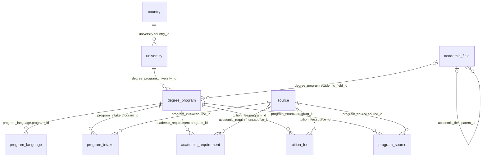

# pgAdmin 4 guide: inspecting the Pathway AI database

This guide lets you open **pgAdmin 4 on Windows** and see every table, column, key, relationship and stored row of the
**local development database**. Nothing here contains a password. Everything below was verified against the running
database on 2026-11-11.

## 1. Verified connection settings (local development)

| Setting | Value |
|---|---|
| Server name in pgAdmin | **Pathway AI - Local** |
| Host | `127.0.0.1` (`localhost` also works) |
| Port | **5433** |
| Maintenance database | `pathway_ai` |
| Username | `pathway` |
| Password | the `DB_PASSWORD` line in `pathway-ai-backend\.env` (git-ignored). Type it into pgAdmin yourself. |
| SSL mode | `prefer` |
| PostgreSQL | 17.11 in Docker container `pathway-ai-postgres` (image `postgres:17`) |
| Data volume | named Docker volume `pathway-ai-backend_pathway_ai_pgdata` (it survives container restarts) |
| Spring Boot | `DB_URL=jdbc:postgresql://localhost:5433/pathway_ai`, no Spring profile set (`SPRING_PROFILES_ACTIVE` is empty) |

> **Port 5433 is the Pathway AI database. Port 5432 is a different, native PostgreSQL 18 on this computer.**
> Your pgAdmin may also contain a server called **"PostgreSQL 18"**. That one points at port 5432, has no Pathway AI
> tables, and looks "empty". If you expand the wrong server you will see nothing useful.

## 2. Launch pgAdmin 4 and register the server

1. Start **Docker Desktop** and make sure the container is running: in a terminal in `pathway-ai-backend` run
   `docker compose ps` (it should say `healthy`). If it is not running: `docker compose up -d`. This does **not** reset
   or recreate your data.
2. Press the Windows key, type **pgAdmin 4**, press Enter. (Installed under `C:\Program Files\PostgreSQL\18\pgAdmin 4`.)
   If pgAdmin asks for a master password, enter the one you chose when you first installed it.
3. In the left tree you should already see **Servers → Pathway AI - Local** (it was added for you). If you do not:
   right-click **Servers → Register → Server…** and fill in:
   - **General → Name:** `Pathway AI - Local`
   - **Connection → Host name/address:** `127.0.0.1`, **Port:** `5433`, **Maintenance database:** `pathway_ai`,
     **Username:** `pathway`, **Password:** your `DB_PASSWORD`, tick **Save password** if you like.
   - Click **Save**.
4. If the entry exists but looks stale or missing, right-click **Servers → Refresh**, or close and reopen pgAdmin.
5. Double-click **Pathway AI - Local**. Enter the password if asked. A green plug icon means connected.

## 3. Find every table

Expand, in this order:

```
Servers
  Pathway AI - Local
    Databases
      pathway_ai
        Schemas
          public
            Tables          <- 11 application tables
            Views           <- empty: the database has no views
            Sequences       <- 8 (the id counters of the tables)
            Functions       <- empty
            Types           <- empty (no custom types; enums are stored as text with CHECK constraints)
```

Empty **Views / Functions / Types** are normal here: this schema has none. The tables are:

| Table | Rows | Columns | What it holds |
|---|---|---|---|
| `country` | 2 | 4 | countries (ISO code + name) |
| `university` | 3 | 9 | institutions; belongs to a country |
| `academic_field` | 12 | 5 | subject taxonomy; a field may have a parent field |
| `degree_program` | 8 | 19 | the programs; belongs to a university and (optionally) a field |
| `program_language` | 13 | 2 | teaching languages of a program (one row per language) |
| `program_source` | 15 | 2 | which official sources back a program (link table) |
| `program_intake` | 9 | 9 | intakes and application deadlines per program |
| `tuition_fee` | 8 | 12 | tuition per program, with the period the source stated |
| `academic_requirement` | 1 | 9 | admission requirements per program and cycle |
| `source` | 14 | 7 | the official web pages every fact cites, with the date they were read |
| `flyway_schema_history` | 4 | 10 | which database migrations (V1 to V4) have been applied |

(Row counts are for 2026-11-11 and change when data is imported.)

There is no table literally named `admission_requirement` or `tuition`: the real names are
`academic_requirement` and `tuition_fee`.

## 4. See the rows

1. Expand **Tables**.
2. Right-click a table, for example `degree_program` → **View/Edit Data → All Rows**.
3. The rows open in a grid on the right. To avoid accidental edits treat this grid as read-only; use the Query Tool
   below for exploring.

## 5. Inspect columns, keys and indexes of a table

Expand the table. You will see these folders:

- **Columns**: name, type, and a key icon for the primary key. Click a column and look at the **Properties** tab on
  the right (name, data type, **Not NULL**, default).
- **Constraints**: expand **Primary Key**, **Foreign Keys**, **Unique**, **Check**. Double-click one to read its
  definition.
- **Indexes**: all indexes, including the unique ones.
- Click the table and open the **SQL** tab at the right for the full `CREATE TABLE` text.

The complete column list (verified from the database catalogue):

#### `academic_field` (5 columns)

| # | Column | Type | Nullable | Default | Key |
|---|---|---|---|---|---|
| 1 | `id` | bigint | NOT NULL | `nextval('academic_field_id_seq')` | PK |
| 2 | `parent_id` | bigint | null |  | FK |
| 3 | `slug` | varchar(120) | NOT NULL |  | UQ |
| 4 | `name` | varchar(150) | NOT NULL |  |  |
| 5 | `created_at` | timestamptz | NOT NULL | `now()` |  |

#### `academic_requirement` (9 columns)

| # | Column | Type | Nullable | Default | Key |
|---|---|---|---|---|---|
| 1 | `id` | bigint | NOT NULL | `nextval('academic_requirement_id_seq')` | PK |
| 2 | `program_id` | bigint | NOT NULL |  | FK |
| 3 | `source_id` | bigint | NOT NULL |  | FK |
| 4 | `application_cycle` | varchar(20) | NOT NULL |  |  |
| 5 | `requirement_type` | varchar(40) | NOT NULL |  |  |
| 6 | `description` | text | NOT NULL |  |  |
| 7 | `minimum_value` | numeric(8,2) | null |  |  |
| 8 | `value_unit` | varchar(40) | null |  |  |
| 9 | `created_at` | timestamptz | NOT NULL | `now()` |  |

#### `country` (4 columns)

| # | Column | Type | Nullable | Default | Key |
|---|---|---|---|---|---|
| 1 | `id` | bigint | NOT NULL | `nextval('country_id_seq')` | PK |
| 2 | `iso2_code` | char(2) | NOT NULL |  | UQ |
| 3 | `name` | varchar(120) | NOT NULL |  | UQ |
| 4 | `created_at` | timestamptz | NOT NULL | `now()` |  |

#### `degree_program` (19 columns)

| # | Column | Type | Nullable | Default | Key |
|---|---|---|---|---|---|
| 1 | `id` | bigint | NOT NULL | `nextval('degree_program_id_seq')` | PK |
| 2 | `university_id` | bigint | NOT NULL |  | FK,UQ |
| 3 | `slug` | varchar(120) | NOT NULL |  | UQ |
| 4 | `name` | varchar(250) | NOT NULL |  |  |
| 5 | `degree_level` | varchar(20) | NOT NULL |  |  |
| 6 | `field_of_study` | varchar(150) | null |  |  |
| 7 | `duration_months` | integer | null |  |  |
| 8 | `teaching_language` | varchar(60) | null |  |  |
| 9 | `created_at` | timestamptz | NOT NULL | `now()` |  |
| 10 | `updated_at` | timestamptz | NOT NULL | `now()` |  |
| 11 | `academic_field_id` | bigint | null |  | FK |
| 12 | `campus_city` | varchar(120) | null |  |  |
| 13 | `study_mode` | varchar(20) | null |  |  |
| 14 | `official_program_url` | varchar(1000) | null |  |  |
| 15 | `official_application_url` | varchar(1000) | null |  |  |
| 16 | `verification_status` | varchar(20) | NOT NULL | `'UNVERIFIED'` |  |
| 17 | `verified_on` | date | null |  |  |
| 18 | `official_admissions_url` | varchar(1000) | null |  |  |
| 19 | `official_application_cycle` | varchar(20) | null |  |  |

#### `flyway_schema_history` (10 columns)

| # | Column | Type | Nullable | Default | Key |
|---|---|---|---|---|---|
| 1 | `installed_rank` | integer | NOT NULL |  | PK |
| 2 | `version` | varchar(50) | null |  |  |
| 3 | `description` | varchar(200) | NOT NULL |  |  |
| 4 | `type` | varchar(20) | NOT NULL |  |  |
| 5 | `script` | varchar(1000) | NOT NULL |  |  |
| 6 | `checksum` | integer | null |  |  |
| 7 | `installed_by` | varchar(100) | NOT NULL |  |  |
| 8 | `installed_on` | timestamp without time zone | NOT NULL | `now()` |  |
| 9 | `execution_time` | integer | NOT NULL |  |  |
| 10 | `success` | boolean | NOT NULL |  |  |

#### `program_intake` (9 columns)

| # | Column | Type | Nullable | Default | Key |
|---|---|---|---|---|---|
| 1 | `id` | bigint | NOT NULL | `nextval('program_intake_id_seq')` | PK |
| 2 | `program_id` | bigint | NOT NULL |  | FK |
| 3 | `source_id` | bigint | NOT NULL |  | FK |
| 4 | `label` | varchar(100) | NOT NULL |  |  |
| 5 | `academic_year` | varchar(9) | null |  |  |
| 6 | `start_date` | date | null |  |  |
| 7 | `application_deadline` | date | null |  |  |
| 8 | `applicant_category` | varchar(20) | null |  |  |
| 9 | `created_at` | timestamptz | NOT NULL | `now()` |  |

#### `program_language` (2 columns)

| # | Column | Type | Nullable | Default | Key |
|---|---|---|---|---|---|
| 1 | `program_id` | bigint | NOT NULL |  | FK,PK |
| 2 | `language_code` | varchar(8) | NOT NULL |  | PK |

#### `program_source` (2 columns)

| # | Column | Type | Nullable | Default | Key |
|---|---|---|---|---|---|
| 1 | `program_id` | bigint | NOT NULL |  | FK,PK |
| 2 | `source_id` | bigint | NOT NULL |  | FK,PK |

#### `source` (7 columns)

| # | Column | Type | Nullable | Default | Key |
|---|---|---|---|---|---|
| 1 | `id` | bigint | NOT NULL | `nextval('source_id_seq')` | PK |
| 2 | `url` | varchar(1000) | NOT NULL |  | UQ |
| 3 | `title` | varchar(300) | NOT NULL |  |  |
| 4 | `publisher` | varchar(200) | null |  |  |
| 5 | `source_type` | varchar(40) | NOT NULL |  |  |
| 6 | `retrieved_on` | date | NOT NULL |  |  |
| 7 | `created_at` | timestamptz | NOT NULL | `now()` |  |

#### `tuition_fee` (12 columns)

| # | Column | Type | Nullable | Default | Key |
|---|---|---|---|---|---|
| 1 | `id` | bigint | NOT NULL | `nextval('tuition_fee_id_seq')` | PK |
| 2 | `program_id` | bigint | NOT NULL |  | FK,UQ |
| 3 | `source_id` | bigint | NOT NULL |  | FK |
| 4 | `academic_year` | varchar(9) | null |  | UQ |
| 5 | `student_category` | varchar(20) | NOT NULL |  | UQ |
| 6 | `amount` | numeric(12,2) | NOT NULL |  |  |
| 7 | `currency` | char(3) | NOT NULL |  |  |
| 8 | `billing_period` | varchar(20) | NOT NULL |  |  |
| 9 | `created_at` | timestamptz | NOT NULL | `now()` |  |
| 10 | `effective_from` | date | null |  |  |
| 11 | `effective_to` | date | null |  |  |
| 12 | `scope_note` | varchar(300) | null |  |  |

#### `university` (9 columns)

| # | Column | Type | Nullable | Default | Key |
|---|---|---|---|---|---|
| 1 | `id` | bigint | NOT NULL | `nextval('university_id_seq')` | PK |
| 2 | `country_id` | bigint | NOT NULL |  | FK |
| 3 | `slug` | varchar(120) | NOT NULL |  | UQ |
| 4 | `name` | varchar(250) | NOT NULL |  |  |
| 5 | `city` | varchar(120) | null |  |  |
| 6 | `website_url` | varchar(500) | null |  |  |
| 7 | `description` | text | null |  |  |
| 8 | `created_at` | timestamptz | NOT NULL | `now()` |  |
| 9 | `updated_at` | timestamptz | NOT NULL | `now()` |  |

## 6. Relationships and the ERD

The foreign keys that really exist in the database (13):



In words:

- University → degree programs: `degree_program.university_id → university.id`
- Degree program → academic field: `degree_program.academic_field_id → academic_field.id` (a field can have a parent field)
- Degree program → languages: `program_language.program_id → degree_program.id`
- Degree program → intakes: `program_intake.program_id → degree_program.id`
- Degree program → requirements: `academic_requirement.program_id → degree_program.id`
- Degree program → tuition: `tuition_fee.program_id → degree_program.id`
- Degree program → official sources: `program_source` links programs and `source`; each intake, tuition and requirement row also points at the `source` it came from.
- University → country: `university.country_id → country.id`

There is no direct link between a university and a source; do not look for one.

**Open the ERD in pgAdmin:** right-click **pathway_ai** (under Databases) → **ERD For Database**. pgAdmin draws all
tables with their foreign keys. Use the toolbar's *Auto-align* if boxes overlap. For one table, right-click the table
→ **ERD For Table**.

To list the same relationships in SQL, run query 5 in section 8.

## 7. Run SQL

1. Click `pathway_ai` in the tree (the Query Tool needs a database selected).
2. **Tools → Query Tool** (or press Alt+Shift+Q).
3. Paste a query and press **F5** (or the play button). Results appear in the **Data Output** tab.
4. Only use `SELECT` while exploring.

## 8. Useful read-only queries

```sql
-- 1. Universities, their countries and how many programs each has
select u.name as university, c.name as country, count(p.id) as programs
from university u join country c on c.id = u.country_id
left join degree_program p on p.university_id = u.id
group by u.name, c.name order by u.name;

-- 2. Programs with university, field, level, verification and links
select u.name as university, p.name as program, p.degree_level, f.name as field, pf.name as parent_field,
       p.duration_months, p.verification_status, p.verified_on,
       p.official_admissions_url, p.official_application_url, p.official_application_cycle
from degree_program p
join university u on u.id = p.university_id
left join academic_field f on f.id = p.academic_field_id
left join academic_field pf on pf.id = f.parent_id
order by u.name, p.name;

-- 3. Tuition and WHICH period each figure belongs to (NULL year and NULL dates mean the source stated none)
select p.slug, t.academic_year, t.effective_from, t.effective_to, t.student_category, t.amount, t.currency,
       t.billing_period, t.scope_note, s.url as source, s.retrieved_on
from tuition_fee t join degree_program p on p.id = t.program_id join source s on s.id = t.source_id
order by p.slug, t.effective_from nulls first;

-- 4. Intakes, deadlines, languages and requirements per program
select p.slug,
       (select string_agg(l.language_code, ',' order by l.language_code) from program_language l where l.program_id = p.id) as languages,
       (select string_agg(i.label || ' (deadline ' || coalesce(i.application_deadline::text, 'unknown') || ')', '; ' order by i.application_deadline) from program_intake i where i.program_id = p.id) as intakes,
       (select count(*) from academic_requirement r where r.program_id = p.id) as requirements
from degree_program p order by p.slug;

-- 5. Every foreign key (the real relationships)
select conrelid::regclass as child_table, a.attname as "column", confrelid::regclass as parent_table
from pg_constraint c
join pg_attribute a on a.attrelid = c.conrelid and a.attnum = any(c.conkey)
where c.contype = 'f' and c.connamespace = 'public'::regnamespace
order by 1, 2;

-- 6. Which sources back each program, and when they were read
select p.slug, s.url, s.title, s.publisher, s.retrieved_on
from program_source ps join degree_program p on p.id = ps.program_id join source s on s.id = ps.source_id
order by p.slug, s.url;

-- 7. Migration history (V1 to V4 should all show success = true)
select installed_rank, version, description, success, installed_on from flyway_schema_history order by installed_rank;

-- 8. Row count of every table
select relname as table_name, n_live_tup as approx_rows from pg_stat_user_tables order by relname;
```

## 9. Current, historical, unknown

The database does not store a "current" flag. Each tuition, intake and requirement row stores the period **its source
stated**; the API (`/api/v1/programs/{identifier}`) derives `temporalStatus` (`CURRENT`, `HISTORICAL`, `UNKNOWN_YEAR`)
from that period and today's date. In pgAdmin:

- `tuition_fee.academic_year` is filled **only** when the page printed an academic year.
- `tuition_fee.effective_from / effective_to` hold a "study right started on or after/before ..." range when the page
  gave one.
- Both empty = the source stated no period. That is stored as unknown, not guessed.

## 10. Refresh and keep the tree in sync

pgAdmin caches the tree. After the backend imports data or migrates, right-click **Tables** (or the database) →
**Refresh**, or press F5 with the node selected. Query Tool results are always live; re-run the query.

## 11. Telling the local database from future production databases

| | Local development | Production (future, not created) |
|---|---|---|
| Where | Docker container on this PC, port 5433 | a managed PostgreSQL on a hosting provider |
| pgAdmin name | `Pathway AI - Local` | use a clearly different name such as `Pathway AI - PRODUCTION` |
| Host | `127.0.0.1` | a provider hostname |
| Credentials | local password in `.env` | provider secret store; never in git |
| Safety | free to experiment | register it **read-only** (a read-only database user) and use a different pgAdmin group and a red server colour (server **Properties → General → Background**) |

Always check the server name in the title of the Query Tool tab before running anything. Never run data-changing SQL
against a database you did not create yourself. Production deployment has not been done and needs your approval.

## 12. Troubleshooting: "pgAdmin looks empty"

An empty tree does not mean the database is empty. Work through this list (all checks were run on 2026-11-11):

1. **Wrong server.** Is the server you expanded **Pathway AI - Local** on port **5433**? The default **PostgreSQL 18**
   entry is port 5432 and has no Pathway data. Right-click a server → **Properties → Connection** to check the port.
2. **Not connected.** A grey cross or no expand arrow means it is not connected. Double-click it and enter the
   password. If you cancelled the password prompt earlier, nothing loads.
3. **Stale tree.** Right-click **Servers → Refresh** or restart pgAdmin (the entry was added to its configuration while
   it was running).
4. **Wrong database.** Expand **Databases** and pick **pathway_ai**, not `postgres`.
5. **Schema collapsed.** Expand **Schemas → public → Tables**. Views, Functions and Types are empty by design.
6. **Permissions.** The `pathway` role owns the database (it is the container's superuser), so permissions are not an
   issue here; a permission problem would show an error, not an empty tree.
7. **Docker not running.** `docker compose ps` must show `pathway-ai-postgres` as `healthy`.
8. **Confirm from SQL.** In the Query Tool run `select current_database(), inet_server_port();` and
   `select count(*) from degree_program;`. Expected: `pathway_ai`, and 8 (or more after later imports).
9. **Spring Boot uses the same database.** While the backend runs, this query lists its connections:
   `select application_name, client_addr from pg_stat_activity where datname = 'pathway_ai';` (you will see
   `PostgreSQL JDBC Driver`).
10. **Never "fix" it by resetting.** Do not run `docker compose down -v`, drop the volume or recreate the schema: that
    deletes your data. A real gap is repaired with the importer (`IMPORT_REFERENCE_DATA=true`), which is idempotent.

## 13. Reopening later

Start Docker Desktop, make sure `pathway-ai-postgres` is up (`docker compose up -d`), open pgAdmin 4, double-click
**Pathway AI - Local**. The backend does not have to be running.
